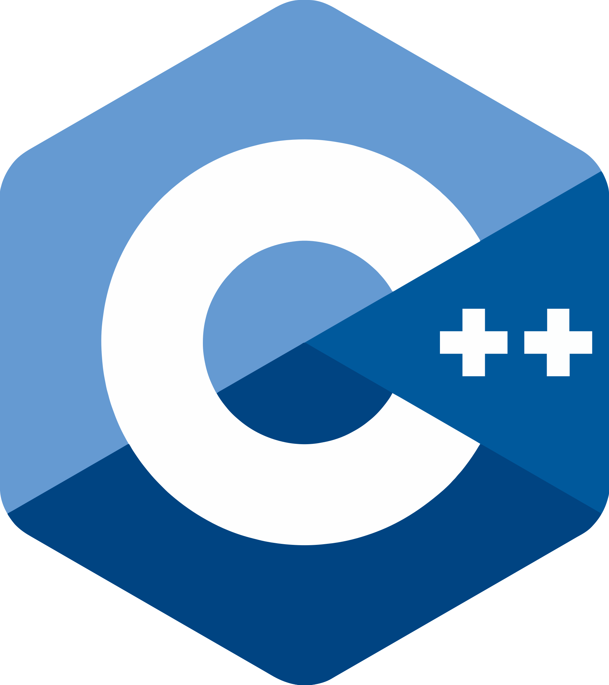
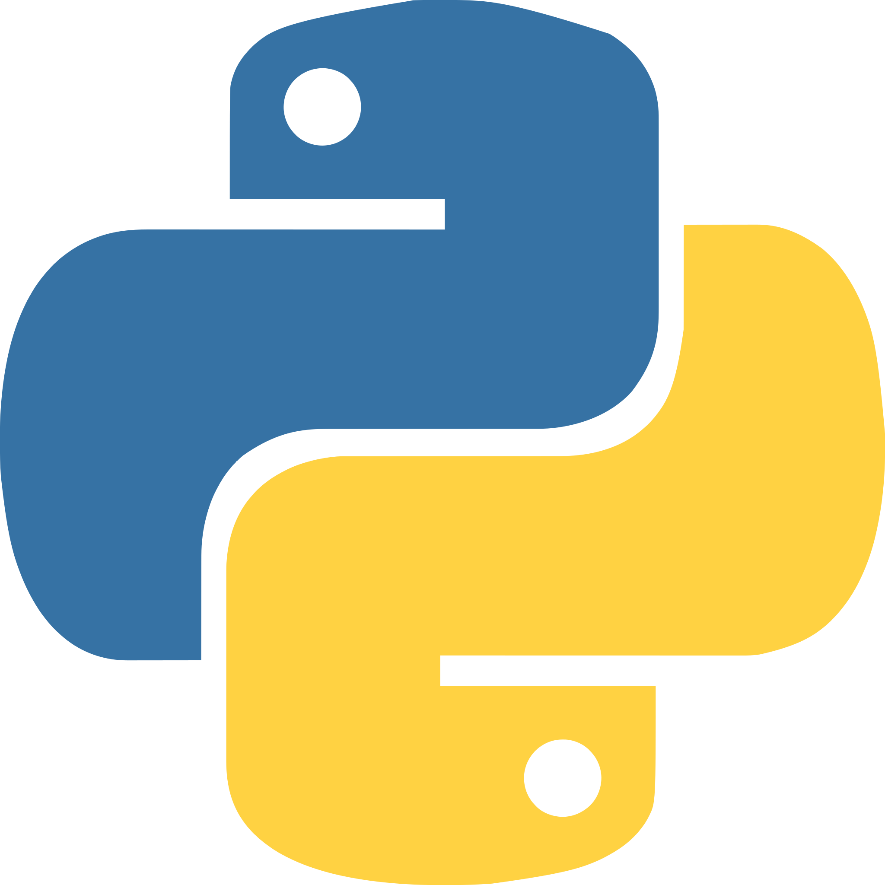
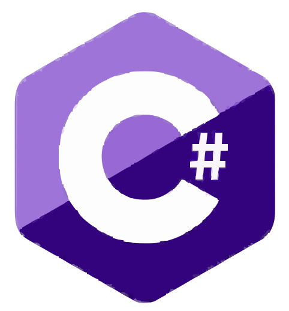

  <h1>Fade-1079</h1>

  

    <code>REVERSE ENGINEERING</code> ·
    <code>GAME MODDING</code> ·
    <code>ENGINE INTERNALS</code>
  

  
  &nbsp;&nbsp;
  
  &nbsp;&nbsp;
  

---

  <table>
    <tr>
      <td align="center" width="50%">
        
        <h2>Unity</h2>
        <code>IL2CPP</code> · <code>Mono</code>
          
        <strong>Reverse Engineering &amp; Engine Internals</strong>
      </td>
      <td align="center" width="50%">
        
        <h2>Unreal Engine</h2>
        <code>UE4</code> · <code>UE5</code>
          
        <strong>Engine Internals &amp; Reverse Engineering</strong>
      </td>
    </tr>
  </table>

   

  <table>
    <tr>
      <td align="center" width="110">
        
         <strong>C++</strong>
      </td>
      <td><strong>Game Modding &amp; Reverse Engineering</strong></td>
    </tr>
    <tr>
      <td align="center" width="110">
        
         <strong>Python</strong>
      </td>
      <td><strong>Scripting, Automation &amp; Analysis Tools</strong></td>
    </tr>
    <tr>
      <td align="center" width="110">
        
         <strong>C#</strong>
      </td>
      <td><strong>.NET &amp; Unity Modding</strong></td>
    </tr>
  </table>

   

  

    
    
  

---

  <h2>Featured Projects</h2>
  <h4>Selected projects &amp; UI development</h4>

  <table>
    <tr>
      <td align="center" width="50%">
        <h3>
          <a href="https://github.com/Fade-1079/Backrooms-Escape-Together-Internal">
            Backrooms: Escape Together
          </a>
        </h3>
        <code>C++</code> · <code>ESP</code> · <code>Player Data</code>
          
        <strong>A C++ Internal Cheat featuring ESP and player-related information. More features and a possible public source release are planned.</strong>
      </td>
      <td align="center" width="50%">
        <h3>
          <a href="https://github.com/Fade-1079/mocher-src-code">
            Mocher
          </a>
        </h3>
        <code>Game Internal</code> · <code>RPCs</code> · <code>C++</code>
          
        <strong>Packed with hundreds of features, including Playerlist, Audio Player, RPCs, RAM crashing, respawn/despawn, desync, protections, and countless other powerful and unique features.</strong>
      </td>
    </tr>
    <tr>
      <td align="center" colspan="2">
        <h3>
          <a href="https://github.com/Fade-1079/Mocha-GUI-Template">
            Mocha GUI Template
          </a>
        </h3>
        <code>ImGui</code> · <code>Custom ImGui Menu</code>
          
        <strong>I Ripped out Mochas GUI and put it here, many people want this GUI, honestly it's overused.</strong>
      </td>
    </tr>
  </table>

   

  <h2>UI Development</h2>
  <h3>
    <code>ImGui</code> ·
    <code>Custom Interfaces</code>
  </h3>
  
<strong>Building clean, custom interfaces with ImGui.</strong>

---

  <h2>Discord</h2>
  <h3><code>@Fade1079</code></h3>

